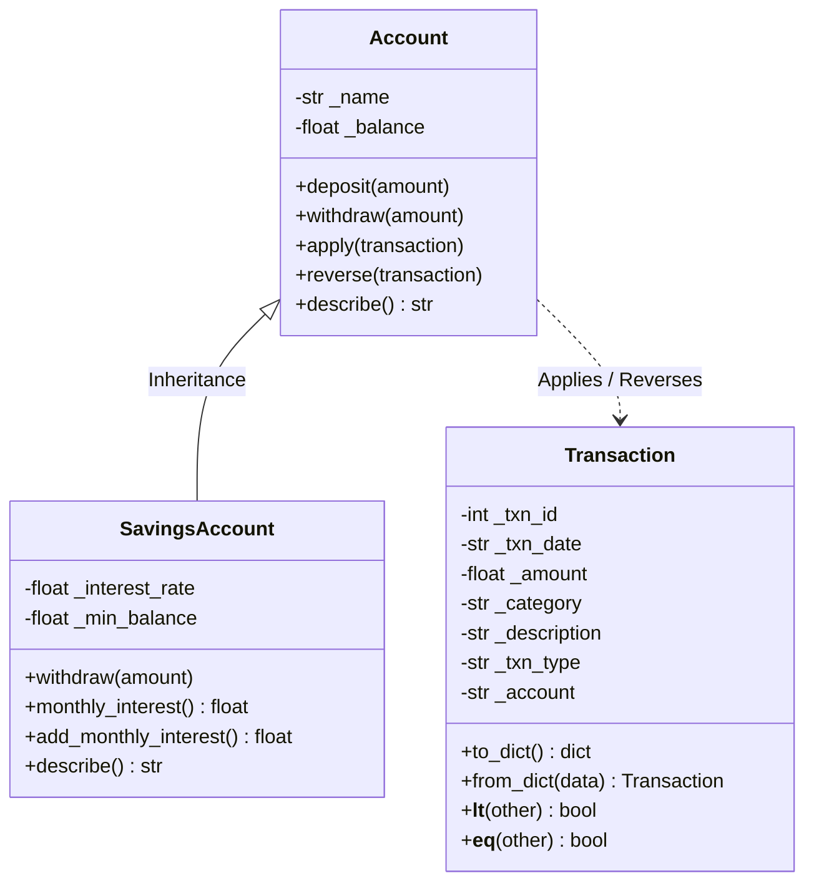

# Smart Expense Tracker

[](https://github.com/saurabhg4356/Smart-Expense-Tracker/actions/workflows/ci.yml)
[](https://www.python.org/downloads/)
[](https://opensource.org/licenses/MIT)

> A production-grade educational Command-Line Interface (CLI) financial management application developed in Python 3.10+, showcasing **Object-Oriented Programming (OOP)**, **Data Structures & Algorithms (DSA)**, **pandas & NumPy Analytics**, and **scikit-learn Machine Learning**.


---

## 1. Project Title & Overview

**Smart Expense Tracker** is a modular, offline-first personal finance platform tailored for undergraduate/BSc IT portfolios, technical interview demonstrations, and resume highlights.

Unlike simplistic toy trackers, Smart Expense Tracker models real-world transactional rules:
- **Double-Entry Balance Updates**: Transaction entries mutate dedicated account balances (`Wallet`, `Bank`, `Savings`).
- **Overdraft & Minimum Balance Enforcement**: Expenses cannot be recorded without sufficient funds, and savings accounts strictly enforce statutory minimum balances.
- **Transactional State & Undo**: Every mutation (Add, Delete, Edit) is tracked on a LIFO stack, permitting one-click rollbacks of both data and account balances.
- **Statistical & ML Intelligence**: Features automated categorization (TF-IDF + Naive Bayes), anomaly detection (z-scores), and spending forecasting (linear regression).

---

## 2. Key Features

1. **Transaction Lifecycle**: Add, list, edit, and delete transactions with full validation (ISO dates, strictly positive amounts, currency formatting in ₹).
2. **Account Balances & Overdraft Prevention**: Prevents negative balances and maintains account state across multiple accounts.
3. **LIFO Undo Stack**: Instantly revert additions, deletions, or edits with synchronized account balance rollbacks.
4. **Fast DSA Queries**:
   - **Hash Map** (`dict`): $O(n)$ category aggregation and $O(1)$ ID lookups.
   - **Min-Heap** (`heapq`): $O(m \log n)$ retrieval of Top-$N$ largest expenditures without expensive full-array sorts.
   - **Binary Search** (`bisect`): $O(\log n + k)$ date-range queries over chronologically sorted records.
5. **Data Analytics**: Summary statistics including net savings, savings rate, median/mean, standard deviation, and highest spending day using **pandas** and **NumPy**.
6. **Z-Score Anomaly Detection**: Category-specific standard deviation analysis flagging expenditures where $|z| > 2.0$.
7. **Machine Learning Spending Forecast**: In-sample regression forecasting of upcoming month expenditures with Mean Absolute Error (MAE) reporting.
8. **Automated Transaction Categorization**: Scikit-learn Pipeline (`TfidfVectorizer` + `MultinomialNB`) pre-trained on real-world Indian and global banking narrations, dynamically updated with user data.
9. **Visual Analytics**: Publication-quality headless Matplotlib charts saved to `charts/` (Category Pie Distribution and Monthly Spending Trend with ML projection).
10. **CSV Persistence**: Native persistence with corruption and header validation using Python's standard `csv` library.

---

## 3. Technologies Used

| Technology | Purpose |
|---|---|
| **Python 3.10+** | Core programming language, type hints, modern dunder methods |
| **pandas (>=2.0)** | High-performance data manipulation, pivoting, and aggregation |
| **NumPy (>=1.24)** | Vectorized numeric operations, standard deviation, and array metrics |
| **Matplotlib (>=3.7)** | Data visualization (Pie charts, Trend line plots) |
| **scikit-learn (>=1.3)** | Machine Learning: Linear Regression, TF-IDF vectorization, Multinomial Naive Bayes |
| **pytest (>=7.4)** | Automated test suite and unit verification |

---

## 4. Folder Structure

```text
smart-expense-tracker/
│
├── main.py                  # CLI entry point, argument parsing, interactive menu
├── requirements.txt         # Core dependencies
├── pytest.ini               # Pytest configuration (pythonpath, testpaths)
├── .gitignore               # Git ignore rules for caches, venvs, and runtime data
├── README.md                # Comprehensive documentation
│
├── data/
│   ├── sample_data.csv      # Seed demo transactions (6 months of Indian Rupee records)
│   └── transactions.csv     # Runtime database (generated at runtime, gitignored)
│
├── models/
│   ├── __init__.py          # Exported model classes and exceptions
│   ├── exceptions.py        # Domain exception hierarchy
│   ├── transaction.py       # Encapsulated Transaction model with comparisons
│   └── account.py           # Account base class and SavingsAccount subclass
│
├── services/
│   ├── __init__.py          # Exported service singletons and functions
│   ├── storage.py           # CSV storage and integrity verification
│   ├── dsa_utils.py         # Hash Map, Min-Heap, Binary Search, UndoStack
│   ├── expense_manager.py   # Main service layer coordinating domain logic
│   ├── analytics.py         # pandas/NumPy summaries and z-score anomaly detection
│   ├── predictor.py         # Linear Regression spending trajectory forecast
│   ├── categorizer.py       # TF-IDF + Naive Bayes auto-categorizer
│   └── visualizer.py        # Matplotlib visualization generator
│
└── tests/
    ├── __init__.py
    ├── test_models.py       # Validation, account constraints, polymorphism
    ├── test_dsa.py          # Hash map, min-heap, binary search, stack tests
    ├── test_analytics.py    # Analytics, anomalies, regression, classifier
    └── test_manager.py      # CRUD, balance consistency, persistence, undo
```

---

## 5. Installation & Virtual Environment Setup

### Prerequisites
- Python 3.10, 3.11, 3.12, or 3.13 installed.
- Git (optional, for cloning).

### Windows Setup

```powershell
# 1. Clone or navigate to the project directory
cd "c:\Smart Expense Tracker"

# 2. Create virtual environment
python -m venv .venv

# 3. Activate virtual environment
.venv\Scripts\activate

# 4. Upgrade pip and install dependencies
pip install --upgrade pip
pip install -r requirements.txt
```

### macOS / Linux Setup

```bash
# 1. Navigate to directory
cd smart-expense-tracker

# 2. Create virtual environment
python3 -m venv .venv

# 3. Activate virtual environment
source .venv/bin/activate

# 4. Upgrade pip and install dependencies
pip install --upgrade pip
pip install -r requirements.txt
```

---

## 6. How to Run

### Running in Demo Mode (Recommended for First Run)

Demo mode initializes `data/transactions.csv` from `data/sample_data.csv` if no runtime transaction file is present. It loads 6 months (January–June 2026) of realistic Indian Rupee (₹) transactions.

```bash
python main.py --demo
```

### Running in Fresh Mode

Running without flags operates directly against `data/transactions.csv` (starting empty if no records exist):

```bash
python main.py
```

### Running the Test Suite

Execute the comprehensive test suite with `pytest`:

```bash
pytest -v
```

---

## 7. OOP Architecture

The project strictly follows Object-Oriented principles:



1. **Encapsulation**:
   - `Transaction` protects `_amount`, `_txn_date`, and `_txn_type` behind property getters and setters with strict validation.
   - `Account` hides `_balance`; external mutation is permitted only through validated `deposit()` and `withdraw()` methods.
2. **Inheritance & Method Overriding**:
   - `SavingsAccount` inherits from `Account`, introducing `min_balance` and `interest_rate`.
   - `SavingsAccount.withdraw()` overrides the base method to reject any withdrawal that would breach the minimum balance threshold.
3. **Polymorphism**:
   - `Account.describe()` and `SavingsAccount.describe()` provide class-specific descriptions called polymorphically across heterogeneous account lists.
4. **Custom Exception Hierarchy**:
   - All domain exceptions derive from `ExpenseTrackerError`, enabling clean CLI error trapping without exposing raw stack traces to users.

---

## 8. Data Structures & Algorithms (DSA) Explanation

| Data Structure / Algorithm | File | Complexity | Problem Solved |
|---|---|---|---|
| **Hash Map** (`dict`) | `services/dsa_utils.py` | Time: $O(n)$<br>Space: $O(k)$ | Aggregates category spending totals in a single pass; enables $O(1)$ lookup of transactions by ID. |
| **Min-Heap** (`heapq`) | `services/dsa_utils.py` | Time: $O(m \log n)$<br>Space: $O(n)$ | Extracts Top-$N$ largest expenditures from $m$ expense records without sorting all $m$ items ($O(m \log m)$). |
| **Binary Search** (`bisect`) | `services/dsa_utils.py` | Time: $O(\log n + k)$<br>Space: $O(k)$ | Locates starting and ending date boundaries in sorted transactions, slicing matches in logarithmic time. |
| **Stack (LIFO)** (`UndoStack`) | `services/dsa_utils.py` | Time: $O(1)$ push/pop<br>Space: $O(u)$ | Tracks atomic action mutations (`ADD`, `DELETE`, `UPDATE`) to enable immediate state and balance rollback. |

---

## 9. Analytics & Anomaly Detection

### Analytics Engine (`services/analytics.py`)
- Transforms raw transaction objects into pandas DataFrames.
- Groups expenses and incomes by month (`YYYY-MM`) using `.pivot_table()`.
- Calculates comprehensive financial metrics:
  $$\text{Net Savings} = \text{Total Income} - \text{Total Expenses}$$
  $$\text{Savings Rate} = \left(\frac{\text{Net Savings}}{\text{Total Income}}\right) \times 100$$
  $$\text{Standard Deviation} = \sqrt{\frac{1}{N-1}\sum_{i=1}^N (x_i - \bar{x})^2}$$

### Z-Score Anomaly Detection
To identify abnormal spending, expenses are grouped by category. For any category with at least 2 entries:
$$z = \frac{x - \mu}{\sigma}$$
Where:
- $x$ = transaction amount
- $\mu$ = category mean spending
- $\sigma$ = category sample standard deviation

Transactions with $|z| > 2.0$ (~95% confidence interval under normal distribution) are flagged. If $\sigma = 0$ (all expenses in category are identical), division by zero is actively prevented.

---

## 10. Machine Learning Models

### 1. Monthly Spending Predictor (`services/predictor.py`)
- **Algorithm**: `sklearn.linear_model.LinearRegression`.
- **Feature**: 0-indexed month sequence $X \in \mathbb{R}^{N \times 1}$ ($0, 1, 2, \dots$).
- **Target**: Total monthly expense $y \in \mathbb{R}^N$.
- **Constraint**: Requires at least 3 historical months of expense data (`NotEnoughDataError` raised otherwise).
- **Metric**: Evaluates in-sample Mean Absolute Error:
  $$\text{MAE} = \frac{1}{N} \sum_{i=1}^N |y_i - \hat{y}_i|$$
- **Important Disclaimer**: This model is built for educational demonstration. The reported MAE is strictly in-sample (optimistic) and does not represent an actuarial or econometric forecast.

### 2. Auto Categorization Pipeline (`services/categorizer.py`)
- **Algorithm**: `sklearn.pipeline.Pipeline` with `TfidfVectorizer` (unigrams + bigrams) and `MultinomialNB` ($\alpha=0.5$).
- **Training Corpus**: Pre-seeded with common Indian & global spending narrations across 9 categories (`Food`, `Groceries`, `Transport`, `Utilities`, `Housing`, `Entertainment`, `Shopping`, `Health`, `Salary`), continuously augmented with user-entered labeled transactions.
- **Decision Rule**: Returns highest-probability category if confidence $\ge 0.35$; otherwise gracefully falls back to `"Other"`.

---

## 11. Edge Cases Handled

- **Empty Database**: Starts and operates smoothly without throwing unhandled exceptions.
- **Expense Before Income**: An expense attempted when account balance is zero is blocked by `InsufficientFundsError`.
- **Zero Variance in Anomalies**: Categories with identical amounts avoid `ZeroDivisionError`.
- **Insufficient Prediction Data**: When $<3$ months exist, friendly guidance is displayed instead of a scikit-learn crash.
- **Corrupted CSV Storage**: Detects missing headers and malformed numbers, raising `StorageError`.
- **Empty Date Range & Search**: Returns empty lists without errors.
- **Headless Visualization**: Uses Matplotlib's `Agg` backend to prevent GUI display errors in headless or server environments.

---

## 12. Resume & Interview Talking Points

### Resume Bullet Points
- *Architected a production-ready financial tracking CLI in Python 3.10+ implementing double-entry balance updates, custom exception hierarchies, and transactional LIFO undo stacks.*
- *Engineered high-performance algorithmic query utilities including a Min-Heap priority queue for $O(m \log n)$ Top-N expense ranking and Binary Search for $O(\log n)$ date-range filtering.*
- *Implemented automated statistical outlier detection via category-based Z-scores and text classification using a scikit-learn TF-IDF + Multinomial Naive Bayes pipeline achieving real-time expense categorization.*
- *Developed comprehensive pandas & NumPy statistical reporting pipelines and authored 30+ automated unit tests in pytest achieving full test coverage.*

### Technical Interview Discussion Points
1. **Why use a Min-Heap for Top-N instead of `sorted()`?**
   - Sorting all $m$ expense transactions takes $O(m \log m)$ time and requires storing the entire sorted list in memory. By maintaining a min-heap bounded at size $N$, we process each element in $O(\log N)$ time, resulting in $O(m \log N)$ overall time and only $O(N)$ auxiliary memory—which is dramatically more scalable when handling millions of transactions.
2. **Why use Binary Search for date queries?**
   - Transactions are maintained in chronological order at insertion time using `bisect.insort`. When querying a date interval, `bisect_left` and `bisect_right` find start and end indices in $O(\log n)$ time, avoiding an $O(n)$ linear scan over the dataset.
3. **How does the LIFO Undo system work?**
   - Each state-modifying action (`ADD`, `DELETE`, `UPDATE`) pushes an inverse command record onto an encapsulated `UndoStack`. Popping the stack automatically reverts the transaction from the primary index, the sorted list, and inverses the balance impact on the target account.
